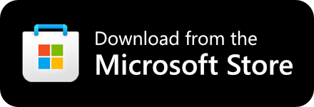

<p align="center">
  
</p>
<h1 align="center">
  miniLook (beta)
</h1>
<p align="center">
  The smallest email reader ever.
</p>
<p align="center">
  <a href="https://apps.microsoft.com/detail/9nwqnmp3xsdk?cid=miniLookGitHub" target="_blank">
    
  </a>
</p>

A compact Outlook mail reader in the Windows notification area.

## What it does

- Click the tray icon to toggle a 400 x 600 mail flyout beside the notification area. It follows the icon's monitor and DPI, uses the taskbar's theme, and dismisses on Escape or a click away. The window stays cached for quick reopening, then closes after one minute hidden. View Focused/Other inboxes, conversations, unread counts, and upcoming calendar events.
- Read mail, mark it read or unread, archive or delete messages, compose mail, reply, and forward. HTML mail uses WebView2; mail and HTML views can open in separate windows.
- Keep a local mail cache, initially covering two months, and load older mail on demand.
- Open the inbox in a separate window. Settings control the app theme, automatic HTML rendering, background tray updates, and cache clearing.
- Right-click the tray icon for Check mail, Open Outlook, and Exit. Check mail opens the mail flyout.

The mail tray icon and tooltip reflect unread mail in the Focused inbox only; a calendar icon can indicate an imminent event when there is no unread Focused mail. The taskbar badge still counts unread mail in both inboxes. Opening a message and going back preserves the selected Focused/Other view.

## Install

Download miniLook from the [Microsoft Store](https://apps.microsoft.com/detail/9nwqnmp3xsdk?cid=miniLookGitHub).

The current source targets Windows 10 version 2004 or later / Windows 11, on x64 or ARM64. Source-built release packages include the .NET and Windows App SDK runtimes. The Store version may lag the source.

There are no published GitHub releases yet. The release pipeline creates an auto-updating `miniLook.appinstaller` feed. After the first GitHub release is published, download and open [miniLook.appinstaller](https://github.com/TheJoeFin/miniLook/releases/latest/download/miniLook.appinstaller); Windows installs the right version for your PC and keeps it updated. Do not install from a loose package or bundle.

Store and GitHub packages have different identities and separate settings, mail caches, and sign-in data. Neither distribution updates the other.

## Setup and privacy

Sign in with a Microsoft account or work/school account that has an Outlook mailbox. Authentication uses MSAL with the Windows WAM broker, with a system-browser fallback. User tokens use MSAL's Windows-protected cache, `msal_cache.dat`, in the package's local cache folder; tokens are not stored in LocalSettings.

When building from source, copy `miniLook\OAuth.resw.example` to `miniLook\OAuth.resw` and set `ClientId` to your Microsoft identity platform public-client app registration. Configure the broker and localhost browser redirect URIs for that registration. The app requests profile, people, mail, calendar, and mailbox-settings permissions. The resource file is gitignored; never put a confidential-client secret in it.

Mail is cached as `MailCacheJson.json` in the package's local cache folder. Theme, HTML preferences, and mail-sync state are stored in package LocalSettings. The mail cache is ordinary JSON, not encrypted by the app; use Settings to clear it. See [Privacy.md](Privacy.md).

**Network and memory behavior:** mail refreshes run every 10 seconds while a flyout or pop-out is visible. Background tray updates remain enabled by default for compatibility, refreshing mail once a minute to keep the Focused unread indicator and imminent-meeting icon current; turn off **Update tray indicators while windows are closed** in Settings for foreground-only refreshes. Calendar refreshes run at most once a minute while visible and once every five minutes in the background; mailbox timezone is cached for the session, and older-history checks run only while visible. Failures back off up to ten minutes, connectivity changes trigger a re-check once the connection settles, and refreshes do not overlap. Opening a window refreshes as soon as any running refresh finishes, and closing one lets it finish at the slower rate. A refresh is canceled when background updates are off and no window is visible, or on connectivity changes, sign-out, cache clearing, and Exit. A canceled or failed refresh continues from its last completed page.

**How mail stays in sync:** the app uses Microsoft Graph delta queries on the inbox. A first sync lists the mail window newest first, 50 messages per request, and shows mail as it arrives. Graph returns at most 5,000 messages for this listing, so a busier mailbox shows its newest 5,000. Later refreshes request only changes. If Graph has expired the saved position, which can happen after a long time away, the app lists the window again and removes any mail that is no longer in the inbox. Mail older than the window is removed from the list as it ages out. When a sign-in can no longer be renewed silently, the app stops refreshing and shows a **Sign in** button rather than prompting from the background.

Optional conversation/calendar/debug UI is loaded only when needed. HTML browsers are created on demand, released when their view closes, and released after one minute in text mode. Attachment listings request metadata only and fill in after the mail has synced, up to 25 per refresh with recent mail first, or immediately when a message is opened; opening a file downloads its bytes on demand into the package's local attachment cache without retaining the byte array. Mail-cache writes use detached snapshots and atomic replacement, and successful unchanged deltas do not rewrite the entire cache. Authentication can also contact Microsoft at startup, and displaying HTML mail can load remote content through WebView2. No measured low-idle-memory guarantee is made.

## Build from source

Install the .NET 9 SDK (the repository's `global.json` selects the 9.0 SDK line), the Windows SDK / WinUI build prerequisites, and WinApp CLI 0.7 or later:

```powershell
winget install Microsoft.WinAppCli
Copy-Item .\miniLook\OAuth.resw.example .\miniLook\OAuth.resw
# Set ClientId in miniLook\OAuth.resw before launching.
# On x64 hosts, replace --arch arm64 with --arch x64.
winapp run .\miniLook\miniLook.csproj -c Release --arch arm64 -p AppxBundle=Never -p UapAppxPackageBuildMode=SideloadOnly --detach
```

`miniLook.Core.Tests` covers mail sync (first sync, incremental changes, resuming, expired positions), Graph request and response handling against canned HTTP responses, recipient validation, polling policy, conversation updates, cache contents, atomic-write failures/cancellation, and attachment cache names without loading WinUI or contacting Microsoft. Run on the native architecture (use `--arch x64` on x64 hosts):

```powershell
dotnet test .\miniLook.Core.Tests\miniLook.Core.Tests.csproj -c Release -p:Platform=ARM64 --arch arm64
```

The sideload-only overrides avoid the project's Store-upload/symbols path when running locally. Store-upload builds need Visual Studio's symbols-conversion tooling (`mspdbcmf.exe`); keep those Store settings for actual Store submissions.

Check both release architectures, the bundle, and its embedded App Installer feed without signing or publishing:

```powershell
.\build-msix-for-gh.ps1 -SkipRelease -NoSign -OutputRoot "$env:TEMP\miniLook-release-check"
```

For a GitHub release, bump `Identity/@Version` in `miniLook\Package.appxmanifest`, commit and push, then run `.\build-msix-for-gh.ps1` from a PowerShell session with the maintainer's `sign-msix` function available. Publish the resulting draft without changing its tag, then run:

```powershell
.\build-msix-for-gh.ps1 -VerifyPublished
```

The script temporarily applies the csproj's GitHub identity and update-feed reference while building, and restores the Store manifest afterward. Do not change either distribution's identity after shipping it. Store builds must not include the GitHub update feed.

The release script is a byte-identical copy of the `winui-tray-app` skill's script. Fix shared release-script bugs in the skill and recopy it rather than editing the repository copy independently.

## License

No license file is currently committed to this repository.
